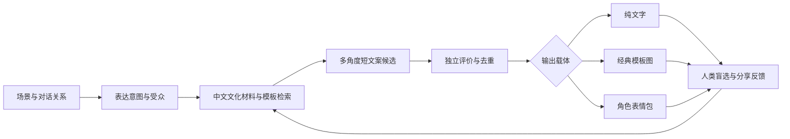

# AI Meme Generation 产品与公开仓库调研

调研日期：2026-09-21。面向 MemePop / ai-meme-gen 的产品与工程决策。

本次整理 **45 个产品/服务/历史线索，47 个公开仓库，以及补充的模型与研究资源**。GitHub 8 组检索取得 623 条结果、去重为 588 个候选；再通过官网、论文和仓库链接补充重点项目。588 是未清洗候选数，混有记忆系统、meme币、普通编辑器和同名无关项目，绝不是588个合格竞品。

这是公开资料覆盖调研，不是穷尽全球所有项目。没有注册付费账号、购买额度、提交生成任务或逐个部署仓库；“官网可访问”“存在代码”“可运行”“好笑”是不同证据等级。本报告的产品能力来自官方页面自述，仓库能力来自README/目录核验；特别注明的技术路线、选型与机会判断属于分析。

## 1. 先看结论

1. **直接竞品已不止“套模板+一句文案”。** Supermeme、Memelord、MagicMeme和Magic Hour都有开发者接入；Memelord还提供图片与视频的异步生成/编辑能力。API/MCP可作为分发渠道，但仅提供这些接口不足以形成差异。[Supermeme API](https://supermeme.ai/meme-api)、[Memelord API](https://www.memelord.com/hackers/docs)、[MagicMeme](https://magicmeme.com/)、[Magic Hour API](https://magichour.ai/api/meme-generator)。
2. **图片梗、聊天贴纸、视频换脸、中文文字段子应分开评估。** 模板笑点依赖格式含义；贴纸强调角色一致与导出；视频依赖动作/音频；文字段子依赖语境和包袱。对MemePop来说，通用生图质量不能代替中文幽默质量。
3. **本次筛出的高关注基础仓库多是渲染和经典研究；近期AI应用常规模较小。** 例如memegen 1,742★、中文meme-generator 1,035★、Dank Learning 483★；这些数值只反映本次GitHub快照，不能当质量排名，也不能外推为全市场结论。
4. **中文机会不只是把英文模板翻译成中文。** MemeTalk把“语义相近”和“适合拿来回嘴”分开检索；MemeXGen专门研究中美文化转创；CFunModel面向中文幽默。可借鉴的是文化资料组织、对话意图匹配和评价方法。[MemeTalk](https://github.com/ShiQu1218/MemeTalk)、[MemeXGen](https://github.com/AIM-SCU/MemeXGen)、[CFunModel](https://huggingface.co/ZhenghanYU/CFunModel)。
5. **“人工评测闭环”已经有人做，不能作为独有创新宣传。** Memelord的HumorBench公开描述固定模板/提示词、匿名成对投票、Bradley–Terry排名、置信区间及AI裁判与人的一致性。页面同时明确当前排名仍是临时结果，依赖AI裁判共识等待更多人工票；不应把它解读为已经成熟的纯人工权威榜。[HumorBench](https://www.memelord.com/humorbench)。
6. **搜索榜单的时效和仓库标签存在明显陷阱。** AutoMemes官网已宣布永久关闭；MemeFast公开仓库主要是宣传；MemeClip公开的是SDK而非生成后端；多个项目README称MIT但没有可见的根目录LICENSE。适合借鉴不等于可以直接投产。

## 2. 市场地图与范围

| 类型 | 用户真正购买/使用的结果 | 代表 | 对MemePop的关系 |
|---|---|---|---|
| 模板梗图 | 场景对应正确格式，再写出可分享caption | Supermeme、Imgflip、Memelord、Predis | 图文化后的直接竞争 |
| 看图写梗 | 给我的照片写一句好笑的话 | MemeCam、Meem AI | 低输入成本的产品入口 |
| IP/聊天表情包 | 同一角色的一套情绪图、透明底、批量导出 | 喵极AI、MakeImg、GrinZero | 微信生态的邻近机会 |
| 视频meme | 人物替换、动作迁移、视频片段配文 | Viggle、Piñata Farms、Insider Memes | 不同成本与传播载体 |
| 中文文字幽默 | 短梗、回嘴、生活段子、单口脚本 | CFunModel、OpenMic、猫meme文案技能 | 当前MemePop最接近的生成任务 |
| 模板/渲染/API | 稳定生成图片或GIF文件 | memegen、MemeCrafters、Imgflip API | 可采购或复用的底座 |
| 检索/评测 | 找对图、理解文化、比较哪条好笑 | MemeTalk、MemeXGen、MER-Bench、HumorBench | 质量与数据层 |

未把通用LLM、通用文生图/文生视频模型、所有ComfyUI工作流逐个计入竞品；它们属于可替代底座。meme币发行、投机交易、同名memory项目不在范围。纯模板编辑器仅在有明确工程或替代价值时单列。

## 3. 产品清单

表中“公开入口/官网可见”只表示本次能读到入口或公开说明，不代表实际生成已验证。价格为页面快照，不同地区、结算周期和套餐可能不同；未知项保留未知。

### 专用图文

| ID / 产品 | 已核验的公开定位 | 价格/状态 | 判断与边界 |
|---|---|---|---|

| P01 [Supermeme.ai](https://supermeme.ai/) | 主题输入→选模板→多候选配文；图片、GIF、多语言、品牌套件；REST API、MCP | 公开入口；每月10个免费credits；付费套餐 | 优先研究模板语义检索、可编辑候选和API产品化；110+语言为厂商宣称，未测中文质量 |

| P02 [Imgflip AI](https://imgflip.com/ai) | 传统模板社区叠加AI配文；图片、GIF、手工编辑 | AI页面有登录/升级门槛；API另计费 | 模板和渲染基础设施优先级高；不能把免费caption_image等同于免费AI |

| P03 [Memelord.com](https://www.memelord.com/) | 热点提醒、Jester AI编辑；另有图片/视频生成API、MCP和HumorBench | 主页要求注册；API按usage balance计费 | 同时研究产品、开发者接入和人工偏好评测；不要与memegenerator.tech同名站合并 |

| P04 [Predis.ai](https://predis.ai/ai-meme-generator/) | 输入主题，AI选模板并配字；可手选模板；社媒内容平台提供meme API能力 | 官网标为免费工具；平台付费能力另算 | 适合研究用免费工具获客、接品牌内容工作流 |

| P05 [MagicMeme](https://magicmeme.com/) | 经典模板配文、换脸、GIF；公开MCP与OpenAPI入口 | 游客每天1批AI；登录去水印，依官网说明 | 值得研究免登录漏斗、模板浏览与Agent接入 |

| P06 [Magic Hour](https://magichour.ai/products/ai-meme-generator) | 模板+主题生成配文，可选Web Search；独立Meme Generator API | 公开工具；API按credits/套餐计费 | 值得研究热点检索进入创作流程；平台累计图片数不能当meme用户数 |

| P08 [Insider Memes](https://www.insidermemes.com/) | 图片与视频meme、AI tagline、编辑、持续更新模板 | 免费注册入口；未核验最终付费额度 | 重点观察职场/B2B场景和热点模板运营；爆款宣传非效果证据 |

| P09 [MemeClip](https://memeclip.ai/) | 文字转图片/视频meme，多语言与模板；有公开Python SDK仓库 | 官网可访问；API文档仍有ToBeDone | 可做产品对标；集成前需验证API开通和实际响应 |

| P13 [GottaMeme](https://gottameme.com/) | 选择模板和场景生成punchline；有原创视觉与GIF/视频入口 | 官网称免费、无水印 | 适合研究先选格式再生成文案；尚未实测 |

| P14 [AI-gen.meme](https://www.ai-gen.meme/) | 从206种经典模板匹配场景，逐文本框写caption | 公开生成入口；未核验付费条款 | 模板含义与槽位约束值得参考 |

| P15 [AI Meme Maker](https://www.aimememaker.co/ai-meme-generator) | 一次6个模板候选；模板、自带图片、纯caption模式；浏览器渲染 | 官网称免费、免登录、无水印 | 适合对标多候选与文字/渲染分离 |

| P16 [Memes AI](https://www.creatememes.ai/) | 场景转多模板、多caption，贴纸、编辑和分享入口 | 免费开始；具体限额未核验 | 长尾产品；用户量、爆款能力不作为已验证指标 |

### 看图写梗

| ID / 产品 | 已核验的公开定位 | 价格/状态 | 判断与边界 |
|---|---|---|---|

| P07 [MemeCam](https://www.memecam.io/) | 上传或拍照，识图后自动生成caption；官网称使用GPT-4o | 公开上传入口；捐助支持API成本 | 最清晰的photo-to-meme交互；官网明确没有App Store/Google Play应用 |

### 移动端

| ID / 产品 | 已核验的公开定位 | 价格/状态 | 判断与边界 |
|---|---|---|---|

| P10 [MemeFast](https://memefast.app/) | iOS/Android/Web入口；文字选模板配文、照片编辑 | 官网列免费+PRO $2.99/月；地区商店价格未实测 | 研究移动创作与分享；GitHub只有README/demo，不是完整开源应用 |

| P11 [Meem AI](https://www.meemai.app/index.html) | 照片→多语言配文→透明贴纸→WhatsApp sticker pack | 官网索引可读；免费试用/奖励tokens | 面向私域聊天，重点看贴纸导出；60+语言为自述 |

| P12 [Meta Meme](https://meta-meme.com/) | 模板编辑，图片/GIF/视频；文本提示AI生成 | 免费基础版；Pro解锁AI和视频等 | 把生成与完整编辑器组合；不是Meta公司产品的已确认归属 |

### 视频/换脸

| ID / 产品 | 已核验的公开定位 | 价格/状态 | 判断与边界 |
|---|---|---|---|

| P17 [Piñata Farms](https://www.pinatafarm.com/ai-memegenerator) | 文本选模板；另有视频/图片meme编辑移动产品 | AI生成页面当前显示waitlist/access code | 产品存在，但该AI入口不能标为全面开放 |

| P18 [Viggle](https://viggle.ai/meme) | 照片人物替换进视频模板；把静态图按参考动作动画化 | 官网称每天5个免费meme；付费提升额度和导出 | 视频人格化的重点对标；同页模板数口径不一致，不采用精确规模 |

| P25 [InVideo](https://invideo.io/make/meme-generator/) | 提示词→视频素材、旁白、音乐和完整短视频 | 免费开始；付费额度另核验 | 更接近自动短视频制作，不是专门模板幽默引擎 |

| P26 [Revid](https://www.revid.ai/) | 短视频生成、字幕、配音、编辑、发布自动化；API/MCP/CLI | 商业平台；未逐项核验meme专项能力 | 邻近竞品：对标生成到分发的流程，不把全部视频都算meme |

### 综合编辑器

| ID / 产品 | 已核验的公开定位 | 价格/状态 | 判断与边界 |
|---|---|---|---|

| P19 [Kapwing](https://www.kapwing.com/meme-maker) | 模板、图片、视频和GIF编辑；页面明确支持AI生成meme | 免费开始，受套餐限制 | 编辑和导出强；不把模板编辑本身都算AI |

| P20 [Canva](https://www.canva.com/create/memes/) | 模板、拖拽、图片/GIF/视频、文字布局和分享 | 基础meme制作免费；素材/其他能力受套餐影响 | 作为替代性设计工具；该页面不足以证明自动懂梗选模板 |

| P21 [Picsart](https://picsart.com/meme-generator/) | 模板和自由文字布局，加入图像模型与AI编辑 | 公开免费入口；高级能力另核验 | 关注已有图像编辑分发渠道，非专门幽默模型 |

| P22 [Fotor](https://www.fotor.com/ai-meme-generator/) | 文本/图片输入生成meme，配套图像编辑 | 公开入口；额度和付费未实测 | 生成素材+编辑套件的替代品 |

| P23 [VEED](https://www.veed.io/tools/ai-image-generator/ai-meme-generator) | 提示词生成图像，再添加caption；可转入视频/语音/GIF编辑 | 平台套餐/credits | 页面流程要求用户补caption，不能等同全自动笑点生成 |

| P24 [Simplified](https://simplified.com/ai-meme-generator) | 主题→模板和caption；连接AI Designer/社媒工具 | 页面称免费；平台限制未实测 | 存在独立帮助教程；对标营销内容工具包 |

### 中文表情包

| ID / 产品 | 已核验的公开定位 | 价格/状态 | 判断与边界 |
|---|---|---|---|

| P27 [MakeImg](https://www.makeimg.org/zh) | 文生图或参考照片生成整组表情，主题/画风与编辑工作台 | 公开入口；有月度付费描述 | 关注整套IP表情的一致性；未实测效果 |

| P28 [喵极AI](https://meow.yyr5.com/) | 角色图生成16张透明底表情，切分与单张GIF升级 | 公开入口；套餐未核验 | 卖的是可交付表情包套装；微信上架通过率未验证 |

| P29 [Niulai 表情包](https://niulai.co/meme-generator) | 人像/宠物/角色生成九宫格，裁剪微调、加字与PNG导出 | 公开上传入口；收费未核验 | 研究生成大图后的切分和编辑体验；不推定与liyupi仓库有关联 |

| P30 [HANYUAI](https://www.hanyuai.com/zh/image-generator/emoji-generator) | 描述+参考图，选择比例、数量、模型生成表情 | 公开表单；实际额度未核验 | 通用图像能力封装为表情包场景 |

| P31 [MemeAI.art](https://memeai.art/) | 照片+模板生成静态/动态表情；平台还有其他AI创作功能 | 官网检索可见；未做生成测试 | 长尾中文产品，不与其他MemeAI同名产品合并 |

| P32 [Homiwork](https://homiwork.com/zh-hans/app/pictures/create/ai-meme-generator) | 文本描述从零生成梗图与文字，提供中文落地页 | 官网检索可见；免费宣传未实测 | 中文页面不代表中文文化效果已通过评估 |

| P33 [Stixel](https://www.stixel.app/zh) | 照片转个性化AI贴纸/表情包 | 官网检索可见；额度未核验 | 偏角色/贴纸生成，与写梗不同 |

| P34 [AI家园·表情包工厂](https://spark1.cn/ai-meme-sticker) | 短台词+画面描述→含中文字的表情图，多种风格 | 页面列30积分/张、首次免费 | 观察显式限制文案长度以改善排版的交互 |

### 平台/基础服务

| ID / 产品 | 已核验的公开定位 | 价格/状态 | 判断与边界 |
|---|---|---|---|

| P35 [YouWare](https://www.youware.com/zh/features/meme-generator) | 提供meme生成场景，并强调用AI创建自己的表情包应用 | 公开功能页；未验证独立生成器边界 | 主要是应用构建平台，不能与独立meme产品直接比较 |

| P36 [腾讯混元生图](https://cloud.tencent.com/document/product/1668/86244) | 官方列AI表情动图等能力；原生接口体系含SubmitMemeJob | 官方提示相关服务向TokenHub迁移，新购入口需再核验 | 中文动图底层服务候选；不是现成的中文幽默生成产品 |

| P37 [JustMeme](https://github.com/JustMeme-wtf/justmeme-api) | 公开API文档：模板搜索、AI选择和配文，返回编辑链接 | 仓库称免鉴权、60请求/分钟；未调用验证 | GitHub主要是文档和examples，不是自托管生成引擎 |

| P45 [Google Photos 创作功能](https://support.google.com/photos/answer/16763021?hl=en) | 当前官方文档确认照片/视频remix；历史社区讨论出现Me Meme | 地区、账户、年龄和每日额度限制 | 当前英语帮助页未确认独立Me Meme入口；列平台威胁，不认定该入口普遍可用 |

### 待核验/历史

| ID / 产品 | 已核验的公开定位 | 价格/状态 | 判断与边界 |
|---|---|---|---|

| P38 [MemeGen AI Online](https://www.memegenai.online/) | 搜索索引有AI图片/视频meme描述 | 直接打开正文为空；功能和收费未确认 | 只保留发现记录，不列为已验证可用产品 |

| P39 [AutoMemes.ai](https://www.automemes.ai/) | 历史上提供视频/帖子/排程界面 | 官网明确宣布永久关闭 | 从当前可用工具推荐中剔除 |

| P40 [Genmeme.ai](https://genmeme.ai/) | 目录站存在AI meme工具记录 | 本次打开无可读正文；索引较旧 | 无法确认当前运营，不据此断言已关闭 |

| P41 [Misgif](https://misgif.app/) | 发现于AI GIF/meme工具目录 | 本次官网抓取超时，未核验功能 | 访问失败不等于停运 |

| P42 [Memegen.lol](https://memegen.lol/) | 待核实的同类产品域名 | 本次工具无法访问 | 不与memegen.link、memegen.me或memegenai.online混为一谈 |

| P43 [Text2Meme.io](https://text2meme.io/) | 工具目录列为AI meme generator | 本次打开遇重定向上限 | 保留线索，不推荐接入 |

| P44 [MemeJourney](https://www.musthave.ai/memejourney/) | 第三方目录仍有产品记录，描述为主题转meme | 未核验一手可用入口；目录免费/付费信息冲突 | 仅为历史线索，收费信息不采信 |

## 4. 最值得深看的产品与商业模式

| 优先级 | 产品 | 核心对标问题 | 建议复现实验 |
|---|---|---|---|
| P0 | Supermeme | 模板语义匹配、多候选、品牌/API收费 | 同一中文场景生成多张，看模板和槽位是否理解正确 |
| P0 | Memelord + HumorBench | 热点提醒、图片/视频API、人工投票评测 | 拆分生成能力与热点运营优势；复用固定渲染的盲选方法 |
| P0 | MemeCam | 最短上传→caption路径 | 自拍/生活照/无人物照片分别测试，检查是否只在描述画面 |
| P0 | Viggle | 个性化视频的分享动机 | 比较换脸/换身体本身的趣味与真正语义笑点 |
| P1 | MagicMeme / Magic Hour | Agent接入、免费入口、模板检索 | 用同主题、同模板分别比较caption，不让视觉画质干扰评分 |
| P1 | Insider Memes | 职场B2B语境和新模板运营 | 通用职场梗与具体公司情境分组比较 |
| P1 | 喵极AI / MakeImg | 中文整套贴纸交付 | 检查角色一致、中文错字、透明边缘、切图完整度 |

商业模式可分为四种：按额度/套餐卖生成（Supermeme），借免费meme功能获取综合内容平台用户（Predis、Simplified），移动端广告/订阅（MemeFast），卖开发者调用（Imgflip、Magic Hour等）。这些分类由公开产品流程推断，不代表已核验各家的收入结构。没有可信的一手收入、留存、利润率数据支持本次横向排名。

### API与集成候选

| 服务 | 真正提供什么 | 已见公开文档 | 主要限制 |
|---|---|---|---|
| [Supermeme](https://supermeme.ai/meme-api) | 模板选择、caption和渲染结果；REST | 付费计划含API；每次可请求多张 | 图片URL文档称仅1小时有效，产品需自行保存；中文效果未测 |
| [Imgflip](https://imgflip.com/api) | 免费模板渲染与付费搜索/AI/GIF | Premium API基础费$9.99/月；各端点有包含额度与超额单价 | `caption_image`是传入文字后渲染，不等于自动写梗；AI接口另看文档 |
| [Memelord](https://www.memelord.com/hackers/docs) | 图片生成/编辑，视频模板配文/编辑，异步结果 | Bearer鉴权，轮询/webhook，另有MCP | API页按usage balance描述；旧MCP页固定credits表与之口径不同，不推算单张美元价 |
| [Magic Hour](https://magichour.ai/api/meme-generator) | 模板+主题，可带网络检索 | 独立API与SDK示例 | 以credits/套餐计费；本次未验证延迟和成功率 |
| [MagicMeme](https://magicmeme.com/) | 模板、配文与Agent工具接口 | Hosted MCP / OpenAPI / llms.txt | 免费网页额度不自动等于免费API额度 |
| [Predis](https://predis.ai/features/) | 品牌社媒内容生成，包含meme | 官方features明确列Memes with API | meme的具体参数、额度及开放条件需要接入前检查 |
| [MemeClip SDK](https://github.com/memeclip/memeclip-ai-api) | 商业服务Python客户端 | 仓库有实现与示例 | 文档/鉴权部分ToBeDone，不能保证即开即用 |
| [JustMeme](https://github.com/JustMeme-wtf/justmeme-api) | 模板查询、AI文字/模板推荐 | 自述免鉴权和限流，返回编辑链接 | 未做服务调用验证；不是已确认返回最终渲染图片的统一替代品 |
| [memegen](https://github.com/jacebrowning/memegen) | 开源可自托管的模板渲染 | 代码、模板、URL/API体系 | 需要自行提供文案与模板选择逻辑 |

## 5. 公开仓库清单

以下47个仓库均读取了GitHub元数据、根目录和可取得的README。另抽读了MemeClip客户端、SamurAIGPT图片生成路由、memetron3000提示模板、GrinZero提示构建器，确认存在相应实现：MemeClip实际封装远程HTTP服务，SamurAIGPT路由处理会话/额度并交给AIService，memetron提示包含文化模板描述和示例，GrinZero明确要求网格布局与统一背景。没有运行代码，也没有进行完整安全审计。Stars和`pushed_at`于2026-09-21查询；push日期可能包括非主分支/文档活动，不能直接当作最后功能更新。许可证列来自GitHub检测，`未识别`不等于没有许可证，也不表示可自由商用；备注记录README/目录中的额外证据。

### AI生成应用

| 仓库 | ★ | 最近push（UTC） | GitHub许可证 | 已读内容与判断 |
|---|---:|---|---|---|

| [ThioJoe/Full-Stack-AI-Meme-Generator](https://github.com/ThioJoe/Full-Stack-AI-Meme-Generator) | 302 | 2023-12-28 | GPL-3.0 | GPT写文字和图像提示→调用生图→合成；完整Python脚本；旧API需迁移 |

| [GrinZero/meme-ai-generator](https://github.com/GrinZero/meme-ai-generator) | 44 | 2026-01-11 | 未识别 | 照片→表情套图→自动切分→去背景→单张编辑/ZIP导出；React/TS；README称MIT但根目录未见LICENSE |

| [SamurAIGPT/ai-meme-generator](https://github.com/SamurAIGPT/ai-meme-generator) | 5 | 2026-07-27 | 未识别 | Next.js/Prisma/Stripe图像视频SaaS骨架，依赖MuAPI；有生成路由；生产就绪仅作者自述，README称MIT但未见LICENSE |

| [IlyaGusev/memetron3000](https://github.com/IlyaGusev/memetron3000) | 15 | 2026-08-19 | 未识别 | 俄语文化模板+描述/示例，VLM生成；FastAPI异步队列、画廊和REST API；值得研究本地文化模板组织 |

| [robuno/meme-generator-ai-agent](https://github.com/robuno/meme-generator-ai-agent) | 3 | 2025-12-02 | 未识别 | BLIP看图+Hugging Face模型写caption+Imgflip，带幽默评分与重试；模型依赖偏旧 |

| [skiku-io/ai_meme_generator_agent_api](https://github.com/skiku-io/ai_meme_generator_agent_api) | 2 | 2025-07-05 | Apache-2.0 | LLM/链式流程+官方Imgflip API；替代浏览器自动化；旧KikuchiSayaka链接可能重定向至此 |

| [pollinations/catgpt](https://github.com/pollinations/catgpt) | 15 | 2026-02-25 | 未识别 | 猫meme垂直玩法，前端、脚本与prompt guide；与voodoohop/catgpt不重复计为独立产品 |

| [vincanger/memerator](https://github.com/vincanger/memerator) | 22 | 2023-10-24 | 未识别 | Wasp应用骨架，含src和迁移；适合看轻量全栈演示，最后push较旧 |

| [jmanhype/MemesPy](https://github.com/jmanhype/MemesPy) | 10 | 2026-03-25；**已归档** | 未识别 | DSPy/FastAPI工作流实验；仓库已归档，不能列为活跃维护 |

| [liyupi/niulai-video-generator](https://github.com/liyupi/niulai-video-generator) | 32 | 2026-08-19 | MIT | 中文故事→LLM剧本→TTS→Three.js程序化动画→FFmpeg；非视频扩散生成；代码MIT不覆盖原作素材 |

| [haodehaode378/cat-meme-generator-skill](https://github.com/haodehaode378/cat-meme-generator-skill) | 3 | 2026-04-21 | MIT | 中文猫meme短视频文案技能与范例；主要产出文字，不是视频模型 |

| [romanbb/ShitPostr](https://github.com/romanbb/ShitPostr) | 2 | 2026-02-10 | MIT | 自托管模板搜索/生成，Ollama语义检索；小型工程参考 |

| [arpedocodes/meme-generator](https://github.com/arpedocodes/meme-generator) | 2 | 2026-06-26 | MIT | 用户指定文本区域→上下文caption；有前后端代码；关注任意图片的文字槽位约束 |

| [piyush-eon/stagehand-chart-meme-generator](https://github.com/piyush-eon/stagehand-chart-meme-generator) | 10 | 2025-04-06 | 未识别 | Next.js+Gemini+Stagehand/Browserbase生成图表梗；垂直形式样例 |

| [ryf-me/Dankly-AI-Meme-Generator](https://github.com/ryf-me/Dankly-AI-Meme-Generator) | 2 | 2026-03-09 | 未识别 | Gemini caption+画布编辑、裁剪、多面板；有src和server，商业复用许可待确认 |

| [Otto-Destiny/meme-generator-with-stable-diffusion](https://github.com/Otto-Destiny/meme-generator-with-stable-diffusion) | 2 | 2025-11-08 | 未识别 | Streamlit/Stable Diffusion生图和文字叠加；README中的微调能力未经复现 |

| [hxlnt/aifunclub](https://github.com/hxlnt/aifunclub) | 85 | 2018-12-06 | 未识别 | 计算机视觉定位脸后生成DEAL WITH IT墨镜动效；传统CV生成，非LLM幽默 |

### 研究/评测

| 仓库 | ★ | 最近push（UTC） | GitHub许可证 | 已读内容与判断 |
|---|---:|---|---|---|

| [Social-AI-Studio/MemeCraft](https://github.com/Social-AI-Studio/MemeCraft) | 13 | 2024-07-25 | 未识别 | WWW 2024上下文/立场驱动生成；含描述、caption、文字合成和安全脚本；研究代码 |

| [ilya16/deephumor](https://github.com/ilya16/deephumor) | 37 | 2021-03-14 | 未识别 | 图像条件meme生成、数据采集和notebook；早期深度学习基线 |

| [suryatejreddy/Memeify](https://github.com/suryatejreddy/Memeify) | 25 | 2020-05-21 | 未识别 | Memeify生成研究代码与数据；旧项目，适合方法溯源 |

| [liuhuanyong/ChineseHumorSentiment](https://github.com/liuhuanyong/ChineseHumorSentiment) | 140 | 2018-12-15 | 未识别 | 中文幽默语料与类型/强度识别；不是写梗生成器，依赖较旧 |

| [DUTIR-Emotion-Group/CCL2019-Chinese-Humor-Computation](https://github.com/DUTIR-Emotion-Group/CCL2019-Chinese-Humor-Computation) | 25 | 2024-08-27 | 未识别 | 中文幽默计算任务数据与baseline；理解/判别任务，不是生产生成器 |

| [sergiomgpinto/MemeFact](https://github.com/sergiomgpinto/MemeFact) | 0 | 2025-05-27 | 未识别具体类型 | RAG生成事实核查meme；含LLM judge和人类研究；README明确无后续开发计划 |

| [festusdrakon/MemeSaheb](https://github.com/festusdrakon/MemeSaheb) | 9 | 2020-10-07 | 未识别 | CNN/LSTM生成caption；历史教学/研究样例 |

| [alpv95/Dank-Learning](https://github.com/alpv95/Dank-Learning) | 483 | 2021-11-16 | MIT | Dank Learning论文代码；Inception-v3+LSTM配文；经典历史基线，非当前技术首选 |

| [one-seven17/MER-Bench](https://github.com/one-seven17/MER-Bench) | 5 | 2026-08-25 | 未识别 | 情绪重评/改写梗图，保留场景与结构；含数据、judge、实验与结果 |

| [AIM-SCU/MemeXGen](https://github.com/AIM-SCU/MemeXGen) | 3 | 2026-05-26 | MIT | 中美双向梗图转创；数据、评分与judge脚本；重点看文化适配和意图保留 |

| [cfiltnlp/AI-OpenMic](https://github.com/cfiltnlp/AI-OpenMic) | 16 | 2022-09-26 | CC-BY-SA-4.0 | EMNLP 2021单口幽默评分代码/数据；不是2026年的中文OpenMic生成论文 |

### Agent/API接入

| 仓库 | ★ | 最近push（UTC） | GitHub许可证 | 已读内容与判断 |
|---|---:|---|---|---|

| [haltakov/meme-mcp](https://github.com/haltakov/meme-mcp) | 57 | 2025-03-12 | Apache-2.0 | TypeScript MCP封装Imgflip；适合已有LLM决定模板和文字后调用，非独立幽默模型 |

| [redblock-ai/imgflip-mcp](https://github.com/redblock-ai/imgflip-mcp) | 14 | 2025-04-01 | MIT | Python Imgflip MCP；轻量接入参考 |

| [nkapila6/mcp-meme-sticky](https://github.com/nkapila6/mcp-meme-sticky) | 12 | 2026-06-11 | MIT | memegen+MediaPipe文本嵌入+FastMCP；可转Telegram贴纸；WhatsApp仍在待办 |

| [memeclip/memeclip-ai-api](https://github.com/memeclip/memeclip-ai-api) | 7 | 2025-04-23 | MIT | 公开Python SDK，有client/models/tests；商业后端未开源；认证和完整文档标ToBeDone |

| [kozko2001/meme-generator-mcp](https://github.com/kozko2001/meme-generator-mcp) | 0 | 2025-12-20 | 未识别 | TypeScript，模板发现、URL内容、memegen渲染；幽默选择依靠MCP客户端模型 |

| [dhruvmehra/makememe](https://github.com/dhruvmehra/makememe) | 2 | 2026-06-09 | MIT | 零依赖Python CLI+Agent skill，封装memegen URL；本身不训练或提供LLM |

| [JustMeme-wtf/justmeme-api](https://github.com/JustMeme-wtf/justmeme-api) | 9 | 2026-05-12 | MIT | README和examples为主的API文档仓库；不能作为自托管实现 |

### 模板/渲染底座

| 仓库 | ★ | 最近push（UTC） | GitHub许可证 | 已读内容与判断 |
|---|---:|---|---|---|

| [jacebrowning/memegen](https://github.com/jacebrowning/memegen) | 1,742 | 2026-08-27 | MIT | memegen.link背后的模板渲染服务；LLM可外接；本身不负责写笑话 |

| [MemeCrafters/meme-generator](https://github.com/MemeCrafters/meme-generator) | 1,035 | 2026-07-06 | MIT | 已迁移至MemeCrafters/meme-generator；中文沙雕表情模板合成；非AI，适合接中文Writer |

| [yeweroooo/memegen](https://github.com/yeweroooo/memegen) | 0 | 2026-05-21 | 未识别具体类型 | Sharp+opentype文字换行、缩放和字体路径；非AI；README区分代码MIT与字体OFL |

| [nextcloud/memegen](https://github.com/nextcloud/memegen) | 1 | 2026-08-18 | 未识别 | Nextcloud SmartPicker接memegen.link；README称有限维护；非AI生成器 |

| [MemeCrafters/meme-generator-rs](https://github.com/MemeCrafters/meme-generator-rs) | 256 | 2026-05-11 | MIT | Rust重构，含Node/Python/CLI/server模块；对当前TS项目有接入参考价值 |

### 检索/中文生态

| 仓库 | ★ | 最近push（UTC） | GitHub许可证 | 已读内容与判断 |
|---|---:|---|---|---|

| [ShiQu1218/MemeTalk](https://github.com/ShiQu1218/MemeTalk) | 60 | 2026-03-23 | 未识别 | 中文梗图语义检索/回嘴检索；OCR、双向量、FTS、重排和评测；检索而非新图生成 |

| [ptonlix/LangChain-Emoji](https://github.com/ptonlix/LangChain-Emoji) | 29 | 2024-05-30 | Apache-2.0 | LangChain表情包斗图Agent；看对话意图与表情选择 |

| [reilxlx/chinese-meme-description-dataset](https://github.com/reilxlx/chinese-meme-description-dataset) | 11 | 2024-07-23 | Apache-2.0 | 中文表情包多模型描述/标注数据与脚本；适合索引和VLM基线，不是成品生成器 |

| [TheD0ubleC/StickerSelector](https://github.com/TheD0ubleC/StickerSelector) | 29 | 2026-01-03 | GPL-3.0 | 将回复意图与表情语义匹配；GPL-3.0；不生成新表情 |

| [anka-afk/astrbot_plugin_meme_manager](https://github.com/anka-afk/astrbot_plugin_meme_manager) | 396 | 2026-09-21 | MIT | AstrBot自动收集、语义发送、WebUI、同步；当前有push；分发/资产管理层 |

### 展示/不完整

| 仓库 | ★ | 最近push（UTC） | GitHub许可证 | 已读内容与判断 |
|---|---:|---|---|---|

| [MrAdex77/MemeFast-AI-Meme-Generator](https://github.com/MrAdex77/MemeFast-AI-Meme-Generator) | 6 | 2026-05-09 | 未识别 | 根目录只有README和demo；产品宣传仓库，未发现完整实现 |

| [gytpku/video-to-wechat-emoji](https://github.com/gytpku/video-to-wechat-emoji) | 7 | 2025-07-23 | MIT | 描述声称智能视频转微信表情，但当前根目录只有LICENSE；不能认定可运行 |

## 6. 补充模型、论文与评测资源

本节区分“已核验公开资产”和“只有论文/尚未定位代码”。论文的任务成功不等于产品在中文用户中有效，旧研究中的相对提升也不能跨数据集拼成排行榜。

| 资源 | 时间 | 公开资产与定位 | 对本项目的用途 |
|---|---|---|---|
| [CFunModel](https://huggingface.co/ZhenghanYU/CFunModel) / [CFunSet](https://huggingface.co/datasets/ZhenghanYU/CFunSet) | 2025 | 中文幽默模型权重与数据；模型卡列Qwen2.5-7B系底座 | 中文文字生成/理解基线；需要与当前通用模型做同场景盲选 |
| [OpenMic](https://arxiv.org/abs/2601.08288) | 2026-01 | 中文3–5分钟单口生成，AutoGen协作、RAG与JokeWriter；本次未定位可确认的作者代码仓库 | 借鉴长程setup/punchline/callback；与当前短梗任务分开 |
| [MemeCraft](https://arxiv.org/abs/2403.14652) | 2024 | 公开生成脚本与评估样本；见仓库清单 | 学习情境、表达意图和图文关系的结构化生成 |
| [MemeXGen](https://arxiv.org/abs/2602.02510) | 2026 | 中美跨文化转创，论文报告6,315对meme；有代码/数据链接 | 评估文化替换、表达意图和图文协同，不只翻译文字 |
| [MER-Bench](https://arxiv.org/abs/2603.15020) | 2026-03 | 负向meme改写为建设性情绪，要求场景/实体/布局保留；有代码 | 衡量可控改写、语义保留、情绪转换；不是单纯搞笑排行榜 |
| [Order Matters](https://arxiv.org/abs/2608.26866) | 2026-08 | 中文多格meme结构、排序与解释评测；本次未核验独立代码入口 | 避免只评单张图，检查多格顺序是否决定笑点 |
| [Dank Learning](https://arxiv.org/abs/1806.04510) | 2018 | Inception-v3+LSTM配文；代码alpv95/MemeProject | 历史生成基线与人类辨别评估方法 |
| [MemeFaceGenerator](https://arxiv.org/abs/1908.05138) | 2019 | 从中文文字生成meme-face的GAN研究；未确认可用作者仓库 | 中国表情包形态的早期研究，不能当现成API |
| [memeBot](https://arxiv.org/abs/2004.14571) | 2020 | 句子→模板选择+caption生成 | 早期“选模板”和“写文字”任务拆解参考 |
| [Multi-modal application: Image Memes Generation](https://arxiv.org/abs/2112.01651) | 2021 | 多模态图像meme生成研究；本次未独立验证代码映射 | 方法补充，避免混同于其他同名项目 |
| [HumorBench](https://www.memelord.com/humorbench) | 本次可见页面最后计算2026-08-13 | 成对盲选、固定渲染、BT排名、AI裁判校准；页面标明排名临时性 | 与MemePop的盲选/笑点实验室直接相关；不采纳其模型名次为中文选型结论 |

## 7. 对MemePop的具体判断

根据本仓库README，当前产品已有场景建模、多个笑点机制、Writer、独立Judge/规则Critics、原创性检查、用户好笑反馈和A/B盲选。这个起点更接近“中文幽默生成与评价”，而多数meme产品从模板和图像编辑起步。这是任务重心的差异，尚不能证明效果优于竞品。

### 优先借鉴的六组资产

| 顺序 | 资产 | 借鉴内容 | 不应直接照搬的部分 |
|---|---|---|---|
| 1 | MemeTalk | OCR/模板/语境/情绪元数据；把回嘴用途与主题相似拆开 | 原有图库及其文化分布不等于微信目标受众 |
| 2 | CFunModel/CFunSet + MemeXGen | 中文幽默基线、文化适配的维度 | 不能把公开语料规模或研究分数当真实用户好笑率 |
| 3 | HumorBench + MemeFact | 固定条件盲选、置信区间、裁判与人类一致性检查 | 模型自评不是最终真值；商业方榜单不代表中立外部认证 |
| 4 | MemeCrafters Python/Rust + memegen | 文字和图像渲染分离、成熟模板形式、中文表情形态 | 模板素材使用权与代码许可证需分别核对 |
| 5 | GrinZero | 整套生成后的切分、去背景、编辑、导出 | IP套图并不自动带来新笑点；客户端密钥架构不能未经检查照搬 |
| 6 | memetron3000 + Memelord API | 文化模板描述、异步任务、生成/编辑、稳定产物管理 | 俄语/英语模板、服务商模型名和额度不直接适用于中文产品 |

### 推荐产品方向（推断）

**第一优先级：中文真实场景→三条可直接发出的梗/回嘴→选择性配图。** 用户输入关系和发生的事，产品提供温和、自嘲、犀利等明确风格，用实际选择和修改记录学习偏好。模板只在能增强笑点时加入；也允许纯文字结果。这最贴近当前仓库能力。

**第二优先级：同一句表达的三种载体。** 同一创意结构分别输出文字、经典模板图、微信表情；保持“想表达什么”一致，以真实分享意愿判断载体价值。不要只根据哪张更精致决定赢家。

**第三优先级：群体语境与时效。** 为职场、家庭、朋友等受众维护小而可评估的文化材料，记录日期、语境、熟悉度、适用对象和失效原因。这个方向有MemeTalk/MemeXGen等相关工作，差异应来自中文场景数据和效果，而非声称首创。

不建议仅凭本调研立刻转成通用文生图工具，也不建议把多Agent数量作为卖点。现阶段更有价值的是证明：在相同场景和成本下，用户更常选中、更少修改、更愿意发送。

### 技术结构建议

这属于组合建议，不是本次已实施的代码变更。优先保留现有Writer/Judge链，增加可控模板渲染及元数据；需要低成本图像输出时优先评估模板路线，需要固定角色贴纸时再走生成图像路线。

## 8. 下一轮实测的可执行设计

本次没有实测产品生成质量，因此不输出“最幽默”“最好用”的伪排名。可沿用项目已有场景集建立以下公平测试：

1. 选60个中文场景：职场、家庭、恋爱、朋友、校园、日常消费各10个；按需要共同背景知识的程度分层。另选20张有授权的生活照片，单独评看图写梗。
2. 每个系统每场景固定取前3个候选，记录生成次数、费用、延迟、失败与人工改动；不挑最好样本替代全部样本。
3. 分三条赛道：纯文字质量；固定同一模板的caption质量；系统自由选模板后的完整图文效果。视频和贴纸套图单独评，不混成总分。
4. 匿名随机展示候选，至少3位目标受众投票，允许“都不好笑”；评分维度：情境贴切、笑点成立、中文自然、新鲜感、愿意发送。
5. 记录Top-1被选率、至少一个可用候选的比例、需要编辑的比例、最终导出/复制/发送意愿以及每条可用结果成本。实际发送必须在用户授权的测试中测，不自动对外发消息。
6. 单独统计Judge与人类投票的一致性；拆开不同圈层结果，并报告样本量和不确定性。只让模型自己判自己容易选出“结构正确但不好笑”的结果。

建议第一轮只跑MemePop、Supermeme、MemeCam、一个通用模型基线和一个固定模板工作流，控制比较规模；登录/付费产品在具体样本和预算确定后再执行。

## 9. 已发现的错误分类与信息冲突

| 容易出现的结论 | 本次核验 |
|---|---|
| “GitHub有仓库就是开源完整产品” | MemeFast只有README/demo；JustMeme主要是API文档；gytpku/video-to-wechat-emoji只有LICENSE |
| “API SDK开源意味着后端可自托管” | MemeClip公开客户端不包含商业生成后端 |
| “meme generator一定有AI” | memegen、MemeCrafters和Nextcloud集成主要负责模板合成 |
| “搜到OpenMic就是2026中文生成系统” | cfiltnlp/AI-OpenMic是2021幽默评分项目；另有大量同名转写工具 |
| “近期push代表持续功能研发” | push可来自文档/分支；MemesPy已归档；MemeFact明确停止后续研发 |
| “旧榜单推荐的工具现在都能用” | AutoMemes官网明确永久关闭；Piñata AI页面是候补名单 |
| “README写MIT就无需再核验” | GrinZero和SamurAIGPT README如此声明，但本次根目录未见LICENSE、GitHub未识别 |
| “模板和产品规模数字可直接横比” | Viggle同页模板数不同；平台累计图片数不等于meme生成数；本报告不把此类数值用于排名 |
| “抓取失败就是停运” | Misgif超时、Text2Meme重定向、若干站无正文，只标待核验 |
| “同名域名是同一家公司” | Memelord.com/memegenerator.tech、多个MemeGen域名没有在本次建立同一归属证据 |

## 10. 检索方法与可复核文件

GitHub REST `search/repositories`使用以下8组关键词，按stars排序，每组最多取前100条；没有遍历全部搜索分页，因此存在低星新项目漏检。通过官网、论文和README的引用补入memegen、MemeCrafters Rust、Dank Learning、MemeXGen、MER-Bench等资产。产品检索覆盖英文AI meme generator、图像/视频meme、中文AI表情包和幽默生成等词。

| GitHub查询 | 命中总数（接口返回） | 本次读取 |
|---|---:|---:|
| meme AI generator | 648 | 100 |
| meme generation | 458 | 100 |
| meme LLM | 294 | 100 |
| AI 表情包 | 130 | 100 |
| 中文 幽默 | 17 | 17 |
| meme MCP | 187 | 100 |
| MemeCraft | 74 | 74 |
| meme caption generation | 32 | 32 |

来源优先级：产品官网/开发者文档、GitHub API与作者README、论文与模型卡；工具目录只用于发现或在待核验区明确标记。没有采用目录流量估计、Reddit营销贴和“必定爆款”宣传作为产品效果证据。

- `products.json`：45条产品结构化记录，包含来源、状态、是否实测。
- `repositories.json`：47条已分类仓库，包含stars、push、许可证识别、判断和证据文件位置。
- `github-search-raw.json`：8组GitHub原始搜索响应，便于复查检索覆盖。
- `github-candidates.json`：588个去重但未清洗候选，不能直接作为相关项目库使用。
- `selected-repo-metadata.json`：48个地址的核验尝试，含1个不存在/未取到的地址；47个进入报告。
- `repo-evidence/`：各仓库元数据、根目录与README快照；若干重点仓库附递归文件树。
- `build_report.py`：本报告与两份结构化清单的生成源，可更新数据后重新生成。

仓库代码只做公开资料读取；没有安装外部项目、执行其脚本、提交付费生成或变更MemePop业务代码。
