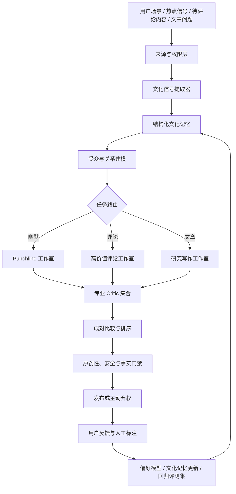

# 中文文本幽默、梗、Punchline 与高价值写作 Agent 调研报告

> 项目：MemePop / ai-meme-gen<br>
> 调研日期：2026-08-06<br>
> 范围：只讨论文字生成，不包含图片、音频和视频生成<br>
> 目标：让 AI 不只是“会造句”，而是能识别中文互联网中的情境、关系、潜台词和情绪，并稳定地产出笑话、梗、punchline、高价值评论和高价值文章。

## 一、结论摘要

### 1. 这件事可以实现，但不能靠一个超级 Prompt

中文互联网幽默并不是“随机反转”或“多说几个网络词”。它要求模型同时完成五件事：

1. 看懂事情表面发生了什么。
2. 看懂人物之间的关系、身份和权力差。
3. 找到大家心里知道、平时又不直说的共同经验。
4. 用最短的话制造一次可回溯的认知转向。
5. 判断这句话对“谁”、在“哪个平台”、于“什么时间”才好笑。

因此，幽默很适合作为 AI 文化理解能力的压力测试。它同时考查语义、语用、共同记忆、社会规范、身份关系、节奏和审美。把它称为 AI 理解人类文化的“最后一道高墙”是一个有力量的产品叙事，但在研究表述上，更准确的说法是：**幽默是检验文化理解是否真正进入社会互动层面的高难度综合任务。**

### 2. 最合适的产品不是“笑话聊天机器人”，而是文本文化智能生产系统

建议建设一个共享底座、三条专业生产线：

- **幽默生产线**：写笑话、梗、punchline、吐槽、段子。
- **评论生产线**：写神评、补充视角、指出隐藏前提、提出好问题。
- **文章生产线**：发现问题、调研证据、组织观点、核验事实、形成高价值长文。

三条线共享文化记忆、受众模型、证据与来源系统、候选生成、评审排序、原创性检查和用户反馈，但使用不同的写作 Agent 与评价标准。

### 3. 当前不存在可以直接调用、稳定写出“中国互联网顶级梗”的万能 API

已有研究和开源项目分别解决了部分问题：

- [CFunModel](https://huggingface.co/ZhenghanYU/CFunModel) 是目前最贴近中文幽默任务的开放模型与数据工作之一，但更适合作为候选模型、研究基线和离线评审对象，不能直接替代完整产品系统。
- [OpenMic](https://arxiv.org/abs/2601.08288) 给出了中文单口喜剧多 Agent 架构，但它更像系统蓝图，不是开箱即用的商业 API。
- [OpenAI Responses API](https://developers.openai.com/api/docs/guides/migrate-to-responses#responses-benefits) 与 [OpenAI Agents SDK for TypeScript](https://github.com/openai/openai-agents-js) 适合作为当前仓库的生产主干。
- [STORM](https://github.com/stanford-oval/storm) 适合作为高价值文章的研究与大纲方法参考。
- [Promptfoo](https://github.com/promptfoo/promptfoo) 适合做 Prompt、模型和 Agent 的离线回归评测。
- [LangGraph](https://github.com/langchain-ai/langgraph) 适合需要显式状态图、暂停恢复和复杂分支的工作流。

### 4. 对当前仓库的推荐

当前仓库已经有场景分析、笑点算子、候选写作、规则评分、原创性守卫和二元反馈。这是很好的**确定性基线、兜底内容池和测试样本**，但还不是能自行学习文化的生成系统。

建议下一阶段采用：

```text
Next.js / TypeScript
+ OpenAI Responses API
+ OpenAI Agents SDK
+ Zod / Structured Outputs
+ PostgreSQL（早期可先用 SQLite）
+ 向量检索或托管 File Search
+ Promptfoo + Vitest
+ 可选 Langfuse 可观测性
```

核心策略是：**先做结构化多阶段生成与真实反馈闭环，再考虑微调。** 不建议一开始就训练大模型，也不建议让多个 Agent 自由聊天后期待它们自动变好。

---

## 二、问题定义：AI 到底需要学会什么

### 1. 幽默不是内容类型，而是一种社会行为

同一句话是否好笑，取决于：

- 说话者和听者是什么关系。
- 谁拥有权力，谁在维护体面。
- 哪些信息是双方默认知道的。
- 这句话在朋友圈、微博、贴吧、群聊还是职场中出现。
- 当下是否仍处在某个热点语境中。
- 笑点是在自嘲、调侃制度、冒犯个人，还是攻击某个身份群体。

[HumorWB](https://aclanthology.org/2024.lrec-main.908/) 把微博幽默和用户互动关系一起建模，说明只看文本会遗漏重要的社会语境。[Chumor 2.0](https://aclanthology.org/2025.findings-acl.1122/) 也显示，模型在文化背景、情境、谐音和文字结构型笑话上仍容易误判或过度解释。

### 2. 中文互联网幽默的特殊困难

- **高语境**：很多内容依赖一句没说出来的潜台词。
- **关系敏感**：老板、父母、伴侣、陌生人、同学说同一句话，意味完全不同。
- **体面机制**：尴尬、羞耻、嘴硬、客套、已读不回、群体沉默，都是常见笑点来源。
- **汉字与语音**：同音、近音、拆字、字形、跨语言错位难以靠普通语义相似度捕捉。
- **时效短**：很多梗快速过气，旧梗套新场景会产生强烈“AI 味”。
- **解释悖论**：模型越努力说明“为什么好笑”，成品越不好笑。
- **受众分层**：学生、打工人、游戏玩家、饭圈用户、程序员的共同经验不同。

### 3. 产品中的“好内容”应当如何定义

建议采用一个工程启发式，而不是把质量等同于模型自评分：

```text
幽默质量 ≈ 情境命中 × 共同经验 × 反转可回溯 × 节奏 × 新鲜度 × 受众匹配
           - 冒犯风险 - 抄袭风险 - AI 味
```

乘法意味着任何一个核心项接近零，整条笑话都可能失效。比如反转很强但与生活无关，只是随机；很贴生活但没有认知转向，只是一句普通抱怨。

高价值评论和文章则不应以“更激烈、更长、互动量更高”为目标：

- **高价值评论**：用尽量少的字，为原内容增加新信息、新视角、新区分或一个真正值得回答的问题。
- **高价值文章**：围绕明确问题，使用可核验来源，覆盖关键视角，处理冲突证据，并给读者带来可迁移的理解或行动框架。

---

## 三、总体实现路径

### 1. 推荐架构



### 2. 为什么应采用“受约束工作流”，而不是自由聊天式多 Agent

多 Agent 的价值主要来自：

- 同时探索不同笑点角度。
- 让专业 Critic 发现具体缺陷。
- 让写作 Agent 只重写有问题的局部。
- 保留每一步可分析的中间状态。

如果只是让几个角色互相讨论，系统会面临输出冗长、成本失控、观点趋同、无法复现和难以评测的问题。建议每个 Agent 都使用严格的结构化输入输出，每一轮都有终止条件，最多局部改写一到两次。

### 3. 共享底座的九个模块

1. **Source Registry**：记录来源、授权方式、抓取时间、有效期和平台限制。
2. **Culture Scout**：识别近期话题、表达习惯和共同情绪，不直接复制原文。
3. **Culture Card Store**：把原始材料蒸馏为可组合的文化卡片。
4. **Audience Model**：描述年龄、生活阶段、圈层、平台、熟悉的梗和敏感边界。
5. **Candidate Studio**：按不同思维角色批量生成互不相似的候选。
6. **Specialist Critics**：分别评估情境、节奏、原创性、价值增量、安全和事实。
7. **Pairwise Ranker**：通过 A/B 比较排序，减少绝对打分失真。
8. **Preference Learner**：从“好笑/不好笑”、原因标签和行为信号中学习。
9. **Eval & Observability**：保存版本、输入、检索证据、候选、评语、成本、延迟和最终结果。

### 4. 模型分工

不必让最强、最贵的模型完成所有环节：

| 环节 | 推荐策略 | 原因 |
| --- | --- | --- |
| 热点与文化信号提取 | 便宜模型 + 检索 | 量大、结构固定、可批处理 |
| 场景和关系理解 | 强模型 + Structured Outputs | 一旦理解错，后续候选都会跑偏 |
| 发散候选 | 中等成本模型，多角色并发 | 需要广度，不需要每条都精修 |
| Top-K 局部重写 | 强模型 | 只把预算花在有潜力的候选上 |
| 初筛 | 规则 + 小模型 | 过滤长度、重复、禁区和明显失败 |
| 最终排序 | 独立 Judge + 轻量偏好模型 | 避免作者兼任裁判 |
| 事实核验 | 检索 + 引文检查 | 文章和评论不能只靠语言流畅度 |

---

## 四、幽默、梗与 Punchline 的实现路径

### 1. 不要从“写一个笑话”开始，要从“还原一个人类时刻”开始

输入可以是用户提供的生活片段，也可以是系统构造的日常场景。第一步先生成一个 `SceneModel`：

```json
{
  "scene": "小朋友被要求跳舞，他小声说不会",
  "characters": [
    { "role": "成年人", "goal": "鼓励孩子", "status": "较高" },
    { "role": "小朋友", "goal": "拒绝表演", "status": "较低" }
  ],
  "publicMeaning": "孩子缺乏自信",
  "privateTruth": "他不是不自信，只是不想跳",
  "tension": ["被当众要求表演", "礼貌拒绝不被接受"],
  "emotion": ["尴尬", "被迫营业", "压抑后的反弹"],
  "socialProtocol": "孩子应礼貌，成年人可以继续劝",
  "comicOpportunity": "把音量误当成自信，把拒绝内容原样放大"
}
```

这里要找的不是形容词，而是：**谁在误读谁、谁在维护什么、哪条社交规则即将发生故障。**

### 2. 使用结构化 Punchline Plan

建议把笑点设计表示为：

```ts
type PunchlinePlan = {
  expectedReading: string;
  revealedReading: string;
  hiddenBridge: string;
  sharedHumanTruth: string;
  target: "self" | "situation" | "institution" | "logic" | "other";
  mechanism:
    | "literalization"
    | "status_reversal"
    | "misdirection"
    | "semantic_transfer"
    | "rule_extremization"
    | "understatement"
    | "callback"
    | "wordplay";
  setupFacts: string[];
  punchKeyword: string;
  rhythm: "one_line" | "two_beat" | "three_beat";
  forbiddenMoves: string[];
};
```

一个有效 punchline 需要让读者在看到结尾后，能够迅速回头解释前面的信息。**意外但无法回溯是随机，能够回溯但毫不意外是陈词滥调。**

### 3. 用“角度房间”发散，而不是一次让模型写二十条同义句

每次选择 4 到 6 个思维角色，各写 2 到 4 条：

- **字面主义者**：故意把客套话、抽象词或命令按字面执行。
- **社会观察者**：寻找体面、身份、权力和关系中的潜台词。
- **逻辑极端派**：把一条规则严格执行到荒诞结论。
- **官僚翻译器**：把情绪翻译成通知、审批、系统状态或 KPI。
- **天真视角**：用儿童式直觉指出成人规则的矛盾。
- **冷静自嘲者**：用低情绪、精确表达描述自己的崩溃。
- **地位反转者**：让原本弱势的一方突然取得解释权。
- **生活细节派**：用工牌、撤回键、外卖备注、家庭群等具体物件落地。

角度角色不是最终文风，它们只负责寻找不同的“认知拐法”。最终编辑 Agent 再统一中文口语、节奏和人物语气。

### 4. 推荐的幽默生成流水线

```text
1. CultureScout：检索近期语言和生活信号
2. HumanTruthExtractor：抽取共同经验、尴尬点和关系压力
3. AudienceModeler：判断目标人群、平台和知识边界
4. AngleRoom：多角度生成 12 到 20 个 Punchline Plan
5. JokeWriter：把每个 Plan 写成 1 到 3 个短文本
6. FastFilters：长度、重复、违禁、解释腔、旧梗模板过滤
7. Critics：情境、反转、节奏、中文网感、原创性、安全分别评审
8. LocalRewriter：只修复被指出的局部问题
9. PairwiseTournament：候选两两比较，选出 Top 1 到 Top 3
10. FinalEditor：去解释、压缩尾句、校准 emoji
11. PublishOrAbstain：没有候选达到门槛时返回备用内容，不强行发布
12. FeedbackLearner：记录偏好和失败原因
```

### 5. Writer 的硬约束

- 默认 2 到 5 句，约 25 到 100 个汉字；允许短到一句。
- setup 只保留建立误导所需的信息。
- 决定性词语尽量放在最后。
- 结尾后不解释笑点，不写“这真是太搞笑了”。
- 每条只使用一个主反转，最多一个补刀。
- emoji 默认 0 到 2 个，只承担语气，不替代笑点。
- 网络词必须服务于具体关系和场景，不能把“破防、社死、松弛感”当万能贴纸。
- 优先调侃自己、逻辑、场景或制度；涉及具体群体时提高安全阈值。

### 6. 专业 Critic 设计

不要只问模型“这条好不好笑，请打 1 到 10 分”。每个 Critic 只负责一组可判断的问题：

| Critic | 要回答的问题 | 常见失败标签 |
| --- | --- | --- |
| Scene Critic | 是否准确利用人物关系和现场压力 | `不贴生活`、`关系读错` |
| Surprise Critic | 结尾是否改变了前文解释 | `没反转`、`随机硬拗` |
| Reconstruction Critic | 读者能否在一秒内补出隐藏连接 | `没看懂`、`需要解释` |
| Rhythm Critic | 能否删词，重音是否落在尾部 | `节奏慢`、`包袱泄露` |
| Culture Critic | 表达是否属于目标人群和当前语境 | `太像AI`、`梗过期` |
| Originality Critic | 是否像来源、训练集或库内旧作 | `像抄的`、`模板复用` |
| Safety Critic | 笑点是否依赖身份攻击或真实伤害 | `有点冒犯`、`对象不当` |

Critic 输出应是短的 `reason_codes`、证据片段和修改指令，不要求暴露长篇内部推理。

### 7. 排序应以成对比较为主

幽默的绝对分数非常漂移。让同一个 Judge 判断“这条是 82 分还是 84 分”意义不大，但判断“A 和 B 哪条更适合 25 岁打工人在群聊里转发”通常更稳定。

建议流程：

1. 规则过滤后保留 8 到 12 条。
2. 按机制分组，先组内淘汰同质候选。
3. 使用独立 Judge 做小型淘汰赛。
4. Top 3 再由偏好模型与业务规则重排。
5. 随机抽样 5% 到 10% 进入人工盲评，持续校准 Judge。

### 8. 用户反馈要从两个按钮升级为“二元选择 + 原因”

当前网页的“好笑/不好笑”非常适合低摩擦冷启动，但不能告诉系统为什么失败。建议保留两个大按钮，在点击后以可跳过的小标签记录原因：

```text
好笑：笑到了 / 太真实了 / 拐得妙 / 想转发
不好笑：太像 AI / 太老 / 没看懂 / 太硬拗 / 不贴生活 / 节奏慢 / 有点冒犯 / 像抄的
```

还应定期插入 A/B 题：“这两条哪条更好笑？” 成对偏好比单条点赞更适合训练排序模型。

### 9. 个性化不是不断重复用户喜欢的词

当前 `joke-engine.ts` 已经按机制、格式和主题维护 affinity，这是正确起点。下一步应把它升级为上下文多臂老虎机或轻量排序模型，输入包括：

- 目标用户对机制、题材、语气、长度的偏好。
- 最近看过的内容，避免机制疲劳。
- 时间、平台、会话状态。
- 笑话的新鲜度和全局质量先验。
- 探索概率，防止系统把用户永远困在一种梗里。

个性化层只决定“给谁看哪一条”，不应直接把用户画像写进敏感或冒犯性内容。

---

## 五、高价值评论 Agent 的实现路径

### 1. 评论的任务不是复述或站队，而是增加边际价值

[Automatic Article Commenting](https://aclanthology.org/P18-2025/) 建立了包含数百万真实评论的中文文章评论数据，并强调质量感知评估。[Read, Attend and Comment](https://aclanthology.org/D19-1512/) 的核心思路是先找到文章的重要点，再围绕这些点生成评论。微博“神评”公开标准也强调独特视角和精准总结，而不是重复原文或进行身份攻击：[微博神评标准](https://weibointl.api.weibo.cn/static/shenping_detail.html)。

因此，建议把评论质量定义为：

```text
单位字数价值 = 新增信息 + 新增区分 + 推理推进 + 可回答的好问题 + 表达精度
                 - 复述 - 空洞态度 - 人身攻击 - 无依据断言
```

### 2. 评论流水线

```text
原文与上下文
-> Claim Mapper：提取主张、证据、情绪和框架
-> Gap Finder：寻找遗漏前提、冲突证据、模糊概念和利益关系
-> Value Mode Selector：选择一种增量方式
-> Comment Writers：生成 6 到 10 条不同类型候选
-> Value Critics：评估信息增量、相关性、具体性、推理、尊重和简洁度
-> Fact / Safety Check
-> Pairwise Ranker
-> 发布或弃权
```

### 3. 八种高价值评论模式

1. 补充一条关键事实。
2. 指出一个被忽略的前提。
3. 给出能改变结论的反例。
4. 把混在一起的两个概念区分开。
5. 用一句更精确的话总结真正矛盾。
6. 提出一个具体、可回答、能推进讨论的问题。
7. 用真实经验连接抽象观点，但不以个案冒充普遍规律。
8. 找到一句人们都感受到、却尚未说出的社会事实。

### 4. 评论 Critic 指标

- `relevance`：是否回应原文真正的主张。
- `information_gain`：是否带来新内容。
- `specificity`：是否使用具体事实和清晰概念。
- `reasoning`：结论是否有可跟随的连接。
- `curiosity`：是否为讨论打开空间。
- `respect`：是否针对观点，而不是贬低身份。
- `frame_awareness`：是否理解原文采用的框架，并有意识地沿用或修正。
- `concision`：删去一句后是否损失价值。
- `originality`：是否只是常见套话或热门评论改写。

[Jigsaw Bridging Comments Benchmark](https://github.com/conversationai/Bridging-Comments-Benchmark-Dataset) 提供了 `Reasoning`、`Curiosity`、`Respect`、`Compassion`、`Alienation` 和 `Moral Outrage` 等标签，可以作为评论 Critic 的开放数据参考。ACL 2026 关于文章框架和评论质量的研究也表明，识别原文框架有助于预测和改善讨论质量：[Framing and comment quality](https://aclanthology.org/2026.findings-acl.701/)。

### 5. 不要只优化互动量

如果奖励函数只看点赞、回复和停留时间，模型容易学会愤怒、极化和冲突诱导。产品应把 `价值增量`、`事实可靠`、`尊重` 与 `互动` 分开记录，并为冒犯和煽动设置硬门禁。

---

## 六、高价值文章 Agent 的实现路径

### 1. 长文的核心不是一次生成，而是研究、组织和核验

[STORM](https://arxiv.org/abs/2402.14207) 通过发现多元视角、模拟作者与专家的研究对话、建立引用库和大纲来生成长文。论文报告其相对普通大纲驱动 RAG 基线在组织性和覆盖广度上有明显提升，但[项目 README](https://github.com/stanford-oval/storm) 也明确提醒，输出距离可直接发表仍需要人工编辑。

### 2. 推荐文章流水线

```text
用户问题
-> Question Tree：把大题拆成可调查的问题树
-> Perspective Scout：发现利益相关者、学派和相反观点
-> Source Retriever：优先检索一手、权威、可引用来源
-> Evidence Cards：记录主张、证据、来源、时间和可信度
-> Contradiction Mapper：标出来源间冲突与证据空白
-> Outline Architect：按问题和论证组织大纲
-> Section Writers：分别撰写段落，只能使用绑定证据
-> Citation Verifier：核对每个可验证主张与来源
-> Adversarial Reviewer：寻找过度推断、遗漏和反例
-> Style Editor：统一语气、删冗余、提高信息密度
-> Human Review：最终发布前的人类确认
```

### 3. 证据卡片

```json
{
  "claim": "中文幽默理解依赖社会关系语境",
  "sourceUrl": "https://aclanthology.org/2024.lrec-main.908/",
  "sourceType": "peer_reviewed_paper",
  "publishedAt": "2024",
  "support": "数据同时包含微博内容与用户互动关系，并以异构图建模",
  "confidence": "high",
  "scope": "该语料与任务设定",
  "possibleConflict": null
}
```

### 4. 使用 RARR 做发布前修订

[RARR](https://arxiv.org/abs/2210.08726/) 的方法是对已生成文本进行检索、归因和局部修改，在尽量保留原文表达的同时修复无来源支持的内容。可以将其思想用于文章和事实型评论：

1. 从草稿中抽取可验证主张。
2. 为每条主张搜索证据。
3. 判断证据是支持、反驳还是无关。
4. 只修改不受支持的句子。
5. 重新检查修改是否破坏上下文。

### 5. 文章指标

- 主张获得来源支持的比例。
- 来源质量与时效性。
- 问题树覆盖率。
- 视角多样性。
- 对冲突证据的处理质量。
- 论证结构和段落信息密度。
- 可操作性与读者收益。
- 原创综合，而不是资料拼接。

---

## 七、数据与文化记忆设计

### 1. 数据来源优先级

从高到低建议为：

1. 用户明确授权提交的生活片段、笑话和反馈。
2. 团队原创并经过人工审核的内容。
3. 许可证清晰的公开研究数据集。
4. 公共网页的趋势和机制信号，仅在平台条款允许的情况下使用。
5. 商业平台内容，只做人工研究或获得明确授权后使用。

不建议批量抓取商业平台的笑话，再做同义改写后发布。这同时带来版权、平台条款、隐私、原创性和模型记忆复现风险。更稳妥的做法是：**蒸馏机制，不保存成品；学习共同经验，不复刻表达路径。**

### 2. 文化卡片，而不是“爆款句子库”

```json
{
  "id": "culture_workchat_silence_001",
  "context": "在工作群误发私人消息后无人回复",
  "audience": ["职场新人", "互联网从业者"],
  "relationship": ["员工-同事", "员工-上级"],
  "surfaceEvent": "没有人说话",
  "sharedHumanTruth": "沉默有时比批评更像公开审判",
  "emotions": ["尴尬", "羞耻", "预期性焦虑"],
  "possibleMechanisms": ["object_transfer", "understatement", "system_notice"],
  "staleAfter": null,
  "sourceSignals": ["source_record_id"],
  "prohibitedReuse": ["原文措辞", "原 punchline 路径"]
}
```

文化卡片应区分：

- **长期人性卡**：嘴硬、体面、拖延、被迫营业、父母式关心。
- **平台语言卡**：某个平台当下的表达节奏和格式。
- **短期热点卡**：带失效日期，过期后不再用于生成。
- **圈层知识卡**：只对特定受众成立，必须检查知识边界。
- **禁用卡**：已被滥用、风险过高或与来源过于接近的模式。

### 3. 建议的数据对象

```ts
type SourceRecord = {
  id: string;
  url: string;
  platform: string;
  fetchedAt: string;
  permission: "licensed" | "public_reference" | "user_submitted" | "unknown";
  retentionPolicy: string;
};

type Candidate = {
  id: string;
  taskType: "joke" | "comment" | "article";
  plan: unknown;
  text: string;
  model: string;
  promptVersion: string;
  cultureCardIds: string[];
  sourceRecordIds: string[];
  criticLabels: string[];
  similarityScore: number;
  status: "draft" | "rejected" | "approved" | "published";
};

type PreferenceEvent = {
  userIdHash: string;
  candidateId: string;
  contextId: string;
  vote: "funny" | "not_funny" | "prefer_a" | "prefer_b" | "skip";
  reasonCodes: string[];
  dwellMs?: number;
  shared?: boolean;
  createdAt: string;
};
```

### 4. 原创性门禁

原创性检查至少需要四层：

1. 精确匹配和规范化匹配。
2. 字符 n-gram、MinHash 或 BM25 相似度。
3. 语义向量相似度。
4. 结构相似度：即使换了名词，setup、误导和 punchline 的路径是否仍与来源一致。

第四层最重要，也最难。可以让 Originality Critic 对两段内容比较 `scene`、`expectedReading`、`revealedReading` 和 `hiddenBridge`，而不是只比较词面。

---

## 八、评测与学习闭环

### 1. 人类评价仍然是金标准

语言模型 Judge 可以提高迭代速度，但不能独立定义幽默。[G-Eval](https://aclanthology.org/2023.emnlp-main.153/) 说明结构化 LLM 评审能够提高与人工评估的一致性，同时也观察到对 LLM 生成文本的偏好风险。2026 年的 NLG 评测回顾仍强调人工评价是最终金标准：[Retrospective Evaluation](https://aclanthology.org/2026.retroeval-main.8/)。

因此应建立三层评测：

- **规则层**：长度、重复、禁区、来源、引用和格式。
- **模型层**：结构化 rubric、成对比较和具体失败标签。
- **人类层**：目标受众盲评、线上真实反馈和定期校准。

### 2. 从少量人工判断归纳自己的 Rubric

[HypoEval](https://aclanthology.org/2026.acl-long.1963/) 探索了从少量人工评价中归纳评测假设与标准，在其任务中仅使用 30 条人工评价也能改善自动评审的一致性。对本项目的启发是：不要永远照搬通用“幽默 1 到 10 分”，而应让真实用户的失败原因逐步形成项目自己的 rubric。

建议冷启动数据：

- 100 个高覆盖生活场景。
- 每个场景 4 到 8 个候选。
- 至少 1,000 到 3,000 组成对偏好。
- 500 条带失败原因的单条评价。
- 由 3 类目标用户分别标注，避免创始人个人审美成为唯一标准。

### 3. 失败报告比一个总分更有用

[LLM Qualitative Judge](https://aclanthology.org/2026.mme-main.7/) 支持让评审模型输出结构化问题报告，而不仅是标量分数。对本项目，建议保存：

```json
{
  "decision": "reject",
  "reasonCodes": ["REVEAL_NOT_RECONSTRUCTIBLE", "AI_PHRASE"],
  "evidenceSpans": ["突然就笑了", "令人忍俊不禁"],
  "repairInstruction": "删去评价性措辞，使最后一个具体动作承担反转",
  "confidence": 0.82
}
```

### 4. 离线指标

#### 幽默

- 人类成对胜率。
- 笑点理解率。
- 情境贴合率。
- “太像 AI”比例。
- 与来源和历史内容的相似度。
- 冒犯率。
- 同批候选的机制多样性。

#### 评论

- 单位字数信息增量。
- 主张相关性与事实支持率。
- 推理、好奇、尊重、具体性。
- 复述率和空洞态度率。

#### 文章

- Claim-to-source 支持率。
- 权威来源比例与时效。
- 关键视角覆盖率。
- 冲突证据处理率。
- 组织性、信息密度和行动价值。

### 5. 在线指标

- `funny_rate`：点击“好笑”的比例。
- `reason_distribution`：失败原因随版本的变化。
- `pairwise_win_rate`：新版本对稳定基线的胜率。
- `dwell_time`：阅读时长，但不能单独解释为喜欢。
- `share_intent` 或真实分享率。
- `repeat_session_rate`：用户是否愿意再次回来。
- `novelty_decay`：同一种机制连续出现后的效果衰减。
- `safety_report_rate`：用户主动报告风险的比例。

### 6. 防止 Judge 偏差和奖励投机

- Writer 和 Judge 尽量使用不同 Prompt，关键实验可使用不同模型族交叉检查。
- Judge 不应看到候选来自哪个模型，也不应总把 A 放在同一位置。
- 定期把线上失败样本加入测试集。
- 保留一个从未用于优化的隐藏测试集。
- 监控网络词密度、夸张程度和攻击性是否因奖励而不断上升。
- 不用单一 LLM 分数直接决定训练奖励。

[OpenAI Evals 指南](https://developers.openai.com/api/docs/guides/model-optimization#build-evals) 同样建议在优化 Prompt 或模型前先建立接近真实生产分布的评测集。

---

## 九、是否需要微调

### 1. 现在不需要

产品早期最大的问题通常不是模型不会写中文，而是：

- 没有清楚定义“什么叫好”。
- 没有目标受众的偏好数据。
- 检索材料不干净或不新鲜。
- Prompt 把场景、计划、写作和评审混在一次调用中。
- 评审模型和用户真正喜欢的内容不一致。

这些问题不会因为微调自动消失。

### 2. 微调的正确顺序

1. 先建立黄金场景、rubric 和成对评测集。
2. 用强模型生成多个候选，经人工审核获得原创高质量样本。
3. 训练轻量排序器，先改善“从候选中选对”的能力。
4. 数据稳定后做 SFT，让 Writer 学会固定结构和风格边界。
5. 只有在奖励可靠、数据量足够时，再评估 DPO、RFT 或在线偏好优化。

[HumorGen](https://arxiv.org/abs/2604.09629) 的实验值得重视：在其幽默任务中，认知角色驱动的数据整理和 SFT 有效，而 DPO 与离线 GRPO 并没有超过 SFT。这说明早期最值得投入的是数据策展和问题表示，不是追逐更复杂的对齐算法。

### 3. CFunModel 的使用方式

[CFunModel 论文](https://arxiv.org/abs/2503.20417) 与 [CFunSet](https://huggingface.co/datasets/ZhenghanYU/CFunSet) 覆盖笑话续写、生成、识别、相声回应和幽默解释等任务，数据规模超过 16 万条。建议用途：

- 作为中文幽默能力的离线基线。
- 参与发散候选，但不直接无审查发布。
- 与通用强模型做 A/B 测试。
- 研究其中文笑点分类和任务设计。

注意事项：

- Hugging Face 模型页目前没有托管 Inference Provider，需要自行部署或下载运行。
- 模型卡未清楚展示完整商业许可链，且子数据来源复杂，商业使用前必须逐项核对许可证。
- 数据含互联网笑话来源，必须做记忆复现和近重复检测。

---

## 十、文献调研

### A. 中文幽默与计算幽默

| 文献 | 年份 | 核心贡献 | 对本项目的直接启发 |
| --- | ---: | --- | --- |
| [Telling the Whole Story: A Manually Annotated Chinese Dataset for the Analysis of Humor in Jokes](https://aclanthology.org/D19-1673/) | 2019 | 9,123 条人工标注中文笑话，包含趣味度、触发词、人物关系、场景、类别和来源等维度 | 建立结构化场景与笑点对象，不只存一句文本和总分 |
| [Can Language Models Make Fun? A Case Study in Chinese Comical Crosstalk](https://aclanthology.org/2023.acl-long.419/) | 2023 | 构建中文相声数据和生成基准，研究语言模型的喜剧创作能力 | 说明对话节奏、角色配合和 callback 可形成独立任务 |
| [HumorWB](https://aclanthology.org/2024.lrec-main.908/) | 2024 | 将中文微博幽默与用户互动关系建成异构图 | 受众和社交关系必须进入输入，不能只做文本分类 |
| [Humor Mechanics: Advancing Humor Generation with Multistep Reasoning](https://arxiv.org/abs/2405.07280) | 2024 | 通过联想、机制选择和多步写作改善 one-liner 的新颖度和幽默度 | 先做联想和计划，再写 punchline；同时增加安全 Critic |
| [Chumor 2.0: Towards Better Understanding of Chinese Humor with a Large Language Model Benchmark](https://aclanthology.org/2025.findings-acl.1122/) | 2025 | 来自弱智吧的中文幽默解释基准，覆盖文化、情境、双关、谐音、字形和跨语言类别 | 建立中文特有的失败集；重点监控文化无知、谐音误判和过度解释 |
| [CFunModel: A Chinese Humor Understanding and Generation Model](https://arxiv.org/abs/2503.20417) | 2025 | 以 Qwen2.5-7B 为基础，使用超过 16 万条多任务幽默数据训练 | 可作为本地基线、候选模型和数据任务设计参考 |
| [AI Humor Generation: Cognitive, Social and Creative Skills for Effective Meme Creation](https://arxiv.org/abs/2502.07981) | 2025 | 将受众、认知、社会和创造技能加入 meme caption 生成流程 | 先提取受众、笑点目标和叙事延伸，再生成文本 |
| [OpenMic: A Multi-Agent System for Chinese Stand-up Comedy Generation](https://arxiv.org/abs/2601.08288) | 2026 | 以 AudienceAnalyzer、ComedyDirector、JokeWriter、PerformanceCoach 和 QualityController 协作生成中文单口喜剧 | 采用 typed shared state、RAG 蒸馏素材和局部多轮改写 |
| [Multi-Agent Comedy Club](https://arxiv.org/abs/2602.14770) | 2026 | 将批评者和模拟观众讨论写入社会记忆，后续检索改进创作 | 保存具体评语和观众反应，而不是只保存分数；监控攻击性上升 |
| [COMIC: Agentic Sketch Comedy Generation](https://arxiv.org/abs/2603.11048) | 2026 | 用 Agent 群体、竞争和观众偏好 Critic 生成喜剧短剧 | 借鉴竞争式候选选择，不采用其视频生成部分 |
| [HumorGen](https://arxiv.org/abs/2604.09629) | 2026 | 使用六种认知 persona 和 Mixture-of-Thought 进行幽默数据策展与训练 | 多样化思维角色和优质 SFT 数据优先于复杂偏好算法 |
| [Re-defining Humor Data Objects](https://arxiv.org/abs/2605.25171) | 2026 | 把幽默重新表示为包含语境、社会互动和解释的结构化对象 | Culture Card 与 Punchline Plan 应保存关系和语用，而不只是文本 |
| [CHum 2026 Workshop Proceedings](https://aclanthology.org/2026.chum-1.pdf) | 2026 | 计算幽默专题论文集 | 用于持续追踪数据、评测和生成研究的新进展 |

### B. 评论与高价值文章

| 文献 | 年份 | 核心贡献 | 对本项目的直接启发 |
| --- | ---: | --- | --- |
| [Automatic Article Commenting: the Task and Dataset](https://aclanthology.org/P18-2025/) | 2018 | 构建大规模中文文章评论数据与人工质量子集 | 评论必须有质量感知评价，不能只学习真实评论的平均分布 |
| [Read, Attend and Comment](https://aclanthology.org/D19-1512/) | 2019 | 先阅读、提取重要点，再围绕文章重点写评论 | 评论 Agent 必须先做 Claim Map 和重点选择 |
| [RARR: Researching and Revising What Language Models Say](https://arxiv.org/abs/2210.08726/) | 2022 | 通过搜索、归因和局部修订提高事实支持度 | 对文章与事实型评论做发布前检索修订 |
| [STORM](https://arxiv.org/abs/2402.14207) | 2024 | 用视角发现、专家对话、引用库和大纲生成有来源长文 | 直接借鉴文章研究和大纲阶段，不把初稿视为可发布成品 |
| [Jigsaw Bridging Comments Benchmark](https://github.com/conversationai/Bridging-Comments-Benchmark-Dataset) | 2024 | 11,973 条评论，标注推理、好奇、尊重、同情、疏离和道德愤怒 | 作为高价值评论 Critic 标签和开放评测数据参考 |
| [Article Framing and Comment Quality](https://aclanthology.org/2026.findings-acl.701/) | 2026 | 在大规模文章评论中研究框架与讨论健康度关系 | 评论前先识别原文框架，再决定沿用、补充或纠偏 |

### C. 自动评测

| 文献 | 年份 | 核心贡献 | 对本项目的直接启发 |
| --- | ---: | --- | --- |
| [G-Eval](https://aclanthology.org/2023.emnlp-main.153/) | 2023 | 使用结构化步骤和表单式评分提高 LLM Judge 与人类的一致性 | 使用明确 rubric，但必须监控 Judge 偏差 |
| [HypoEval](https://aclanthology.org/2026.acl-long.1963/) | 2026 | 从少量人工评价中归纳任务特定评价假设 | 用真实用户的原因标签持续更新项目 rubric |
| [LLMs as Qualitative Judges](https://aclanthology.org/2026.mme-main.7/) | 2026 | 让模型输出细粒度问题报告，而非只有总分 | Critic 保存错误类型、证据片段和局部修改建议 |
| [Retrospective Evaluation of NLG](https://aclanthology.org/2026.retroeval-main.8/) | 2026 | 回顾自动与人工 NLG 评测的关系 | 自动 Judge 用于规模化，人工评测保留最终裁决权 |

---

## 十一、开源工作与开源工程

| 项目 | 能解决什么 | 与当前仓库的适配度 | 主要注意事项 | 建议 |
| --- | --- | --- | --- | --- |
| [OpenAI Agents SDK for JavaScript/TypeScript](https://github.com/openai/openai-agents-js) | Agent、工具、handoff、guardrail、session、trace 和人工介入 | 很高，当前仓库就是 TypeScript 且 Node 版本满足要求 | 需要自己设计工作流和评测，不会自动获得幽默能力 | **作为 MVP 主编排层** |
| [LangGraph](https://github.com/langchain-ai/langgraph) | 显式状态图、持久执行、记忆、暂停恢复、人类介入 | 高 | 抽象和运行复杂度高于简单 SDK | 流程分支明显增多后采用，或作为 Agents SDK 的替代方案 |
| [Microsoft AutoGen](https://github.com/microsoft/autogen) | 多 Agent 会话和研究原型，OpenMic 使用该体系 | 中 | 当前仓库 README 已提示进入维护模式，新项目推荐 Microsoft Agent Framework | 只参考 OpenMic 架构，不建议新系统以它为核心 |
| [Microsoft Agent Framework](https://github.com/microsoft/agent-framework) | Python/.NET 的生产 Agent 与顺序、并发、handoff、群聊工作流 | 中低 | 当前产品是 TypeScript，跨语言部署成本更高 | 团队已有 Python/.NET 基础时再考虑 |
| [DSPy](https://github.com/stanfordnlp/dspy) | 把 LM 流程写成可优化的模块，支持 RAG 和 Agent 程序 | 中 | Python 生态，需要单独服务 | 用于后期 Prompt/模块优化研究，或承载 STORM |
| [STORM](https://github.com/stanford-oval/storm) | 有来源的长文研究、视角发现和大纲生成 | 高，针对文章模式 | 输出仍需人工编辑；Python | 复用方法或部署成独立文章研究服务 |
| [CFunModel / CFunSet](https://huggingface.co/ZhenghanYU/CFunModel) | 中文幽默理解与生成基线 | 中高 | 无托管推理、许可证链和互联网语料复现风险需核查 | 做离线 benchmark 和可选候选模型 |
| [Promptfoo](https://github.com/promptfoo/promptfoo) | Prompt、模型、RAG 和 Agent 的批量评测、比较与 CI | 很高 | 需要自己提供高质量测试集和断言 | **立即接入回归门禁** |
| [Langfuse](https://github.com/langfuse/langfuse) | Trace、Prompt 版本、数据集、评测和成本观测 | 高 | 增加基础设施和隐私治理工作 | 流量上来后接入，早期可先自建最小 trace 表 |
| [Dify](https://github.com/langgenius/dify) | 可视化工作流、RAG、Agent、Prompt IDE 和 API | 中高 | 核心许可证包含 Apache 2.0 之外的附加条件；深度定制奖励闭环较受限 | 非工程团队快速验证流程时使用 |
| [Coze Studio](https://github.com/coze-dev/coze-studio) | 可视化 Agent、工作流、知识库、插件与 API | 中高 | 自部署需要额外安全和运维治理 | 中文团队快速搭原型和运营后台时使用 |
| [RAGFlow](https://github.com/infiniflow/ragflow) | 文档理解、切分、检索、重排和引用 | 文章线高，笑话线低 | 对短文化卡片可能过重 | 用于长文证据库，不必作为笑话 MVP 的前置依赖 |
| [FastGPT](https://github.com/labring/FastGPT) | 知识库、RAG 和可视化工作流 | 中 | 深度自定义评价与学习循环仍需编码 | 适合快速验证中文知识工作流 |

### 推荐开源组合

**当前仓库直接开工：**

```text
OpenAI Agents SDK + Responses API + Structured Outputs
+ Promptfoo + Vitest
+ PostgreSQL / SQLite
+ 自建最小 Trace 和 Feedback 表
```

**文章功能增强：**

```text
STORM 方法或独立 Python 服务
+ Web Search / RAGFlow
+ RARR 式事实修订
```

**未来模型自托管：**

```text
CFunModel 作为基线
+ 自有授权数据 SFT
+ 独立排序器
```

---

## 十二、可调用产品与平台

### 1. OpenAI 平台

| 能力 | 用法 | 在本项目中的位置 |
| --- | --- | --- |
| [Responses API](https://developers.openai.com/api/docs/guides/migrate-to-responses#responses-benefits) | 统一模型调用、工具循环和有状态上下文 | 所有 Writer、Critic 和 Router 的模型入口 |
| [Structured Outputs](https://developers.openai.com/api/docs/guides/structured-outputs) | 约束模型严格返回 JSON Schema | `SceneModel`、`PunchlinePlan`、`Critique`、`EvidenceCard` |
| [Web Search](https://developers.openai.com/api/docs/guides/tools-web-search) | 带引用搜索、来源列表和域名过滤 | 热点信号、文章研究、事实型评论核验 |
| [Evals](https://developers.openai.com/api/docs/guides/model-optimization#build-evals) | 数据集化测试、版本比较与优化闭环 | Prompt 或模型上线前的回归门禁 |
| [Agents SDK](https://github.com/openai/openai-agents-js) | 编排工具、handoff、guardrail、session 和 trace | 当前 TypeScript 工程的 Agent 层 |

产品优势是集成成本低、工具和结构化输出完整；限制是需要自行提供中文文化数据、评价标准、版权治理和偏好学习，API 本身不会自动变成“懂中文梗”的专用产品。

### 2. Dify / Coze / FastGPT

这些平台适合快速拖出工作流、让内容运营调整 Prompt、查看运行过程，并通过 API 接入网页。它们适用于：

- 验证 Agent 顺序和字段设计。
- 非工程同事调试文化卡片和 Prompt。
- 搭建内部审核台。

但本项目真正的壁垒会在偏好数据、排序器、原创性门禁和评测集。若全部逻辑长期锁在可视化流程中，复杂实验、版本控制和线上个性化会变得困难。建议把它们作为原型或运营控制面，而不是唯一核心。

### 3. 本地模型服务

CFunModel、Qwen 系列或其他中文开放模型可以通过 vLLM 等推理服务自部署。适合在以下条件成立后引入：

- 日调用量足以覆盖 GPU 与运维成本。
- 有清楚的许可证审计。
- 有自己的测试集证明本地模型在目标场景具有优势。
- 有安全、内容去重、弹性和监控能力。

在冷启动期，使用托管强模型构建数据闭环通常更快。

### 4. 产品判断

目前最现实的“现成方案”不是单个产品，而是一套组合：

```text
生产生成：OpenAI Responses API
Agent 编排：OpenAI Agents SDK（或 LangGraph）
中文幽默基线：CFunModel
文章研究：STORM + Web Search
离线评测：Promptfoo + 自有人工偏好集
可观测性：Langfuse 或自建 Trace
快速原型/运营：Coze 或 Dify
```

---

## 十三、针对当前 ai-meme-gen 仓库的开发计划

### 阶段 0：先定义“什么叫更好”

**目标：** 防止接入模型后只能凭感觉改 Prompt。

工作项：

- 从现有原创笑话库和真实生活场景中整理 100 个基准场景。
- 为每个场景准备好、一般、失败候选及原因标签。
- 建立 `evals/humor-scenes.jsonl` 和 Promptfoo 配置。
- 固定当前规则系统为 `baseline-v1`。
- 建立人工 A/B 标注页。

验收：任何新版本都能报告相对 `baseline-v1` 的成对胜率、AI 味、重复率和风险率。

### 阶段 1：接入结构化生成 MVP

**目标：** 在不微调的情况下，从真实场景生成多样候选。

建议代码结构：

```text
src/
  agents/
    culture-scout.ts
    scene-modeler.ts
    angle-room.ts
    punchline-planner.ts
    punchline-writer.ts
    critics/
      scene-critic.ts
      surprise-critic.ts
      rhythm-critic.ts
      culture-critic.ts
      safety-critic.ts
      originality-critic.ts
    pairwise-ranker.ts
    final-editor.ts
  schemas/
    scene-model.ts
    punchline-plan.ts
    critique.ts
  services/
    model-client.ts
    trace-store.ts
    culture-store.ts
  evals/
```

API：

```text
POST /api/generate/joke
POST /api/feedback
POST /api/compare
GET  /api/feed/next
```

验收：每个输入场景生成至少 12 个机制不同的候选；Top 1 必须通过结构、原创性与安全门禁；失败时使用当前原创内容池兜底。

### 阶段 2：文化记忆与细粒度反馈

**目标：** 让系统开始理解“为什么这个用户觉得不好笑”。

工作项：

- 建立 `culture_cards`、`candidates`、`critiques`、`feedback_events` 和 `source_records` 表。
- 在现有两个大按钮后增加可跳过原因标签。
- 增加 A/B 评价任务。
- 为热点卡设置 `stale_after`，自动退出生产检索。
- 建立来源相似度和结构相似度门禁。

验收：能够按人群、场景、机制和失败原因查看命中率；每条发布内容都能追溯 Prompt、模型、文化卡片和评审版本。

### 阶段 3：候选预生成与个性化排序

**目标：** 在保证页面即时响应的同时，利用用户偏好。

工作项：

- 后台离线生成并审核候选池。
- 在线请求只做个性化重排，避免用户每点一次等待多轮模型调用。
- 使用轻量 ranker 或上下文多臂老虎机。
- 按机制、主题、措辞和最近曝光做多样性约束。
- 保留 10% 左右探索流量。

验收：页面下一条近乎即时出现；新排序策略在隐藏 A/B 中稳定超过随机与当前 affinity 规则。

### 阶段 4：评论与文章模式

**目标：** 复用文化与评测底座，增加两条专业生产线。

工作项：

- 评论：Claim Map、Gap Finder、Value Mode、评论 Critic。
- 文章：Question Tree、Evidence Card、Outline、Citation Verifier、RARR 式修订。
- 网页上为不同任务提供独立入口和历史记录，不把三种输出混在同一 Prompt。

验收：评论有可测的信息增量；文章中的关键事实都绑定可打开来源。

### 阶段 5：模型优化

**进入条件：** 已有稳定 rubric、足够人工偏好、清楚的失败分布和许可证明确的原创训练集。

工作项：

- 先训练候选 ranker。
- 再用审核后的原创样本进行 Writer SFT。
- 对比通用模型、CFunModel 与自训模型。
- 只有离线和在线双重收益成立时才部署自托管模型。

### 当前文件的处理建议

| 当前模块 | 建议 |
| --- | --- |
| `src/agents/scene-analyzer.ts` | 保留为规则基线；新增模型版 `scene-modeler.ts`，共用 schema |
| `src/agents/punchline-writer.ts` | 将现有模板作为 fallback；新增 Plan 驱动 Writer |
| `src/agents/humor-critic.ts` | 保留快速规则过滤；拆分专业 LLM Critics |
| `src/agents/originality-guard.ts` | 扩展为词面、语义和结构三层相似度 |
| `src/web/joke-engine.ts` | 保留本地 affinity；逐步迁移为服务端用户偏好与 ranker |
| `src/data/original-joke-corpus.ts` | 作为兜底池和回归样本，不当作唯一训练真值 |
| `app/components/MemeMachine.tsx` | 保留双按钮主交互，增加轻量原因标签和 A/B 任务 |

---

## 十四、性能、成本与可运营性

### 1. 不要把十几个 Agent 串在用户点击之后

在线生成会同时带来 5 到 30 秒延迟、调用成本和失败波动。推荐双轨：

- **离线轨**：定时抓取允许使用的信号，生成候选，评审、去重后进入内容池。
- **在线轨**：根据用户偏好、最近曝光和新鲜度，从内容池即时选下一条。

只有用户明确输入私人场景时，才触发在线定制生成，并显示合理的生成状态。

### 2. 预算分配

- 文化卡片缓存，避免每次重新总结来源。
- 候选并发生成，但限制每个角色数量。
- 先用规则和便宜模型淘汰明显失败，再调用强 Judge。
- 只对 Top-K 做强模型重写。
- 批量处理离线任务。
- 为每条最终发布内容记录总 token、延迟和候选数。

### 3. 必须支持主动弃权

系统没有好候选时，应返回“本轮未通过质量门槛”，或从已审核池中选择备用内容。强行从低质量候选里选第一名，只会让排序器稳定地发布“最不差的一条”。

---

## 十五、安全、版权与平台边界

### 1. 来源治理

- 遵守平台服务条款、robots 规则和访问限制。
- 不绕过登录、付费墙、验证码或反爬机制。
- 不批量转载完整内容。
- 保存来源、访问时间、许可状态和删除策略。
- 研究数据集不等于可以商业使用，逐项检查许可证和原始来源。
- 对来源许可不明的文本，最多提取统计或机制信号，不进入训练和发布库。

### 2. 内容治理

- 禁止针对种族、地域、性别、疾病、残障等身份属性的贬损性笑点。
- 对未成年人、性内容、自残、真实灾难和具体个人指控采用更高门槛。
- 对事实型评论和文章执行来源核验，避免诽谤与无依据断言。
- 对用户输入做个人信息最小化和脱敏。
- 不把单个用户的敏感偏好用于推断或生成攻击性内容。

### 3. 原创性不是“换几个同义词”

弱智吧年度内容评选把原创性检查和大众投票分开，是很有价值的产品启发：[弱智吧 2025 年度佳贴评选](https://tieba.baidu.com/p/10354221105)。MemePop 也应把“是否好笑”和“是否原创”设为两个独立门禁。商业平台上的高赞内容可以帮助研究受众、节奏和机制，但不能成为自动洗稿流水线。

---

## 十六、最终技术决策建议

### 现在就做

1. 使用 OpenAI Responses API 和 Agents SDK 建立结构化 Agent 工作流。
2. 保留当前规则引擎作为兜底与可比较基线。
3. 先建设 100 个场景和 1,000 到 3,000 组成对偏好的评测集。
4. 每次生成 12 到 20 个不同机制候选，通过专业 Critic 和成对排序选一个。
5. 在网页二元按钮后增加失败原因标签和少量 A/B 任务。
6. 把商业平台内容限制为趋势与机制信号，建立来源和原创性门禁。
7. 使用 Promptfoo 将“太像 AI、过时、硬拗、需要解释、像抄的”变成持续回归测试。

### 暂时不做

1. 不从零训练基础模型。
2. 不急于做 DPO、GRPO 或复杂强化学习。
3. 不让 Agent 无限制自由讨论。
4. 不在每次翻页时同步运行完整创作流水线。
5. 不把点赞率当成唯一奖励。
6. 不直接抓取商业笑话做同义改写。
7. 不把研究模型的排行榜成绩等同于产品质量。

### 最关键的产品飞轮

```text
更真实的生活场景
-> 更清楚的情绪、关系与潜台词表示
-> 更多机制不同的原创候选
-> 更专业的失败诊断与排序
-> 更低摩擦的真实用户反馈
-> 更好的受众模型、文化卡片和评测集
-> 下一轮更贴近人的内容
```

真正的壁垒最终不是某个 Prompt，也不是调用哪一家模型，而是：

1. **一套能描述中文生活中微妙关系和情绪的数据结构。**
2. **一套知道“为什么不好笑”的高质量偏好数据。**
3. **一套能持续淘汰抄袭、旧梗、硬拗和冒犯内容的评测系统。**
4. **一套把研究、创作、批评、排序和人类反馈连起来的产品闭环。**

当系统能在“尴尬、羞耻、嘴硬、体面、沉默、关系压力”这些难以明说的体验中，找到准确、克制、可回溯的一句 punchline 时，它才不只是会模仿中文，而是在开始参与中文文化。

---

## 十七、参考链接汇总

### 中文幽默

- [Telling the Whole Story](https://aclanthology.org/D19-1673/)
- [Chinese Comical Crosstalk / C3](https://aclanthology.org/2023.acl-long.419/)
- [HumorWB](https://aclanthology.org/2024.lrec-main.908/)
- [Humor Mechanics](https://arxiv.org/abs/2405.07280)
- [Chumor 2.0](https://aclanthology.org/2025.findings-acl.1122/)
- [CFunModel paper](https://arxiv.org/abs/2503.20417)
- [CFunModel model](https://huggingface.co/ZhenghanYU/CFunModel)
- [CFunSet dataset](https://huggingface.co/datasets/ZhenghanYU/CFunSet)
- [AI Humor Generation](https://arxiv.org/abs/2502.07981)
- [OpenMic](https://arxiv.org/abs/2601.08288)
- [Multi-Agent Comedy Club](https://arxiv.org/abs/2602.14770)
- [COMIC](https://arxiv.org/abs/2603.11048)
- [HumorGen](https://arxiv.org/abs/2604.09629)
- [Re-defining Humor Data Objects](https://arxiv.org/abs/2605.25171)
- [CHum 2026 Proceedings](https://aclanthology.org/2026.chum-1.pdf)

### 评论、文章与评测

- [Automatic Article Commenting](https://aclanthology.org/P18-2025/)
- [Read, Attend and Comment](https://aclanthology.org/D19-1512/)
- [RARR](https://arxiv.org/abs/2210.08726/)
- [STORM paper](https://arxiv.org/abs/2402.14207)
- [STORM project](https://github.com/stanford-oval/storm)
- [Jigsaw Bridging Comments Benchmark](https://github.com/conversationai/Bridging-Comments-Benchmark-Dataset)
- [Article Framing and Comment Quality](https://aclanthology.org/2026.findings-acl.701/)
- [G-Eval](https://aclanthology.org/2023.emnlp-main.153/)
- [HypoEval](https://aclanthology.org/2026.acl-long.1963/)
- [LLMs as Qualitative Judges](https://aclanthology.org/2026.mme-main.7/)
- [Retrospective Evaluation of NLG](https://aclanthology.org/2026.retroeval-main.8/)

### 工程与产品

- [OpenAI Responses API](https://developers.openai.com/api/docs/guides/migrate-to-responses#responses-benefits)
- [OpenAI Structured Outputs](https://developers.openai.com/api/docs/guides/structured-outputs)
- [OpenAI Web Search](https://developers.openai.com/api/docs/guides/tools-web-search)
- [OpenAI Evals](https://developers.openai.com/api/docs/guides/model-optimization#build-evals)
- [OpenAI Agents SDK for TypeScript](https://github.com/openai/openai-agents-js)
- [LangGraph](https://github.com/langchain-ai/langgraph)
- [Microsoft AutoGen](https://github.com/microsoft/autogen)
- [Microsoft Agent Framework](https://github.com/microsoft/agent-framework)
- [DSPy](https://github.com/stanfordnlp/dspy)
- [Promptfoo](https://github.com/promptfoo/promptfoo)
- [Langfuse](https://github.com/langfuse/langfuse)
- [Dify](https://github.com/langgenius/dify)
- [Coze Studio](https://github.com/coze-dev/coze-studio)
- [RAGFlow](https://github.com/infiniflow/ragflow)
- [FastGPT](https://github.com/labring/FastGPT)
